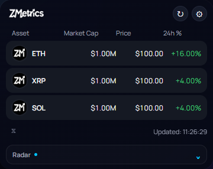
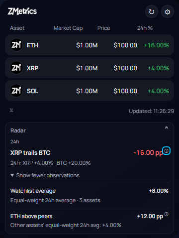

# ZMetrics — Public Source Code for Transparency

A compact Chrome extension for cryptocurrency prices, market caps and 24-hour changes,
with a toolbar popup, floating window and on-device Smart Market Radar.

**Published v1.4.8 reference.** The 18 application/asset files in this tree match
the package delivered by Google's update service on October 18, 2026, subject only
to Google's added manifest update URL and signed metadata. CRX signatures and the
Chromium Store publisher key were verified. See [release evidence](docs/release-reference.json).
The matching local v5 ZIP is identified by content; its exact upload provenance
still requires the publisher's record. No badge/alarms or later attribution changes
are included in this historical reference.

**Copyright (c) 2026 ZMetrics contributors. All rights reserved.** Original source
is visible for transparency and independent security auditing. No general right to
reuse, modify, redistribute or commercialize it is granted. Applicable law, hosting
terms and third-party licenses remain unaffected. This is not OSI open source.
See [copyright/usage notice](COPYRIGHT.txt) and [licensing boundaries](docs/LICENSING.md).
The legal owner/asset credits remain subject to confirmation before publication.

[Chrome Web Store](https://chromewebstore.google.com/detail/ipihfpalipjpdoboegoemfhfldcpdeke)
· [Privacy](PRIVACY.md) · [Security](SECURITY.md) · [Copyright and usage](COPYRIGHT.txt)

## Features

- Prices, market caps and 24-hour changes in USD or EUR.
- Search, select, remove and reorder watchlist assets.
- Toolbar popup and a resizable floating window sharing market-data requests.
- Default shortcut: **Ctrl+Shift+Z** on Windows/Linux, **Command+Shift+Z** on macOS.
  Chrome shortcut conflicts can require configuration at `chrome://extensions/shortcuts`.
- Local Radar observations comparing assets, peers and a BTC benchmark.
- Accessible Radar disclosures and percentage-point explanations.
- Locally stored read-state shared between the two views.

Radar uses equal-weight comparisons, not wallet balances or portfolio returns.
Its observations are descriptive heuristics, not predictions or investment advice.
Provider rate limits, outages and stale data can affect availability.

## Screenshots

| Compact popup | Expanded Radar |
| --- | --- |
|  |  |

Screenshots show synthetic test quotes, not current market prices. They illustrate
the 1.4.8 interface; they are not Chrome Web Store listing assets.

## Install

For a normal installation and automatic updates, use the official Chrome Web Store
link above. Check the listing for the currently published version.

To reproduce the package for an authorized audit (see the usage notice):

1. Install Node.js **24.x**. The validation environment uses **24.13.1**.
2. From this repository directory, run:

   ```sh
   npm run check
   npm test
   npm run package
   node scripts/verify-release.js
   npm run verify:reference -- dist/extension
   ```

3. Open `chrome://extensions`, enable **Developer mode**, choose **Load unpacked**
   and select `dist/extension`.
4. Pin ZMetrics to the toolbar, open it, and configure the shortcut if needed.

No `npm install`, API key, environment file, backend account, bundler or private
configuration is required. Tests use Node's built-in runner and mocked provider
responses. The extension itself needs CoinGecko access for current quotes and search.
Unpacked installations can have a different ID and storage from the Store version;
they do not prove an in-place Store upgrade.

## Build and test

The readable root `.js`, `.html` and `.css` files are the complete runtime source.
Local copying, execution or modification remains subject to the usage notice.
`npm run test:coverage` reports coverage. `npm run check` validates the explicit
public-source inventory, syntax, permission boundary and credential patterns.

`npm run build` creates the unpacked extension; `npm run package` builds and also
creates the ZIP and hash manifests. Choose one on a fresh checkout: both refuse an
existing `dist/extension`. Move a previous `dist` aside before rebuilding.
The scripts work on Windows, macOS and Linux using Node alone; CI is prepared for
Windows and Linux. Only the local Windows run has been verified during preparation.

There are no production or development npm dependencies and therefore no dependency
lockfile. `package.json` is marked private solely to prevent accidental npm publication.
It is not a grant of software rights; the license field is `UNLICENSED`.

## Privacy and permissions

- `storage`: Chrome Sync watchlist/display preferences, local Radar read-state,
  and the floating-window ID in session storage (local fallback).
- `https://api.coingecko.com/*`: market prices and asset search.
- Coin images load from `assets.coingecko.com` or `coin-images.coingecko.com`.
- Fonts, styles and executable code are bundled. There are no content scripts,
  browsing-history access, analytics identifiers, accounts or wallet connections.

CoinGecko receives requested asset IDs, currency, search text and ordinary request
metadata. A nonempty market query also includes BTC as a benchmark even if BTC is
not selected. Chrome may synchronize preferences. Radar observations and local
read-state are not sent to a ZMetrics server. See [the full explanation](PRIVACY.md).

## Source and release verification

All **18 package files** match the published application payload. The exact
inventory and hashes are in [release-reference.json](docs/release-reference.json).
Copyright/third-party notices, documentation, tests, screenshots and build tools
are source-only, so rebuilding does not add files to the historical Store package.
The bundled `fonts/OFL.txt` remains in the package unchanged.

The ZIP uses sorted stored entries with a fixed timestamp and no compression or
OS metadata, so identical inputs produce identical ZIP bytes. Hash manifests tie
the package to its public source. The local v5 ZIP matching the Store payload used another ZIP format;
its archive hash is intentionally different. Runtime payload hashes remain equal.

CI validates source, tests, packaging and reference hashes. It does not upload,
submit or publish releases. See [the release procedure](docs/RELEASING.md) for tags,
checksums and comparison against an installed Store package. A checksum published
by a maintainer does not by itself prove Store equivalence.

## Data attribution and licensing

Data provided by [CoinGecko](https://www.coingecko.com/en/api/). API, data,
coin images and trademarks have separate rights. No provider endorsement is implied.
The published UI lacks visible provider credit; this snapshot faithfully records
that state. Attribution/terms and plan entitlement require resolution before the
source announcement and a separately versioned corrective Store release if needed.
[Third-party notices](THIRD_PARTY_NOTICES.md) preserve Manrope's SIL OFL and both
font copyright notices. Those permissions are unaffected by the project's reserved rights.

Website, backend, AI experiments and private development tooling are excluded.
See [security reporting](SECURITY.md), [privacy](PRIVACY.md) and
[licensing boundaries](docs/LICENSING.md).
